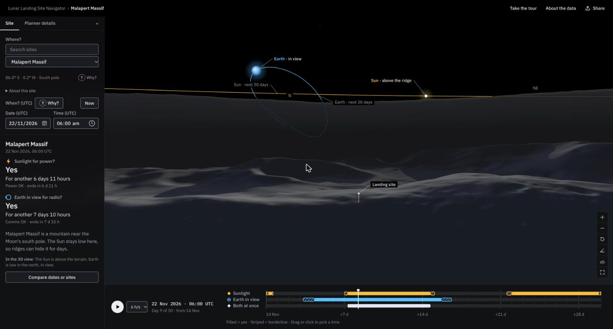

# Ridgelight

A lunar landing site navigator, built for the NASA Space Apps Challenge 2026 challenge "Lunar Landing Site Navigator". Near the Moon's south pole, ridges decide when a lander gets light; Ridgelight shows when.

Pick a lunar site and a date. See the real terrain around the site in 3D, with the Sun and Earth over its horizon, and get plain answers: is there sunlight, is Earth in view, and when does that change? A time dock shows the next 30 days. A compare drawer sets up to four site and date options side by side, such as a two-week launch slip.

**Live demo:** https://lunar-landing-site-navigator-alpha.vercel.app



Built for the NASA Space Apps Challenge 2026. Not affiliated with or endorsed by NASA.

## The problem

Near the Moon's south pole the Sun stays close to the horizon, so ridges and crater rims decide when a site has light. Earth also drifts in and out of view, which decides when a lander has a direct line to it. Existing tools are slow for asking what happens at a site if the date moves.

## What it does

**For a mission planner**
- **Two plain answers.** "Sunlight for power?" and "Earth in view for radio?" Each says Yes, Not yet or No, and how long until it changes. Power OK means at least half the Sun's disk is above the horizon. Comms OK means Earth's centre is at least 0.5° above it. These are geometry rules, not power or link budgets.
- **Time dock.** Three 30-day lanes: Sunlight, Earth in view, Both. Filled means yes, striped borderline. Drag, click or press Play.
- **Planner details tab.** Elevation, visible disk, azimuth, time to the next change.
- **Compare.** Up to four options, each with a site, start date and delay (-60 to +60 days). Shows sunlight share, longest dark period and a verdict.
- **Events tab.** Lists every sunrise, sunset, Earth rise and Earth set in the 30 days, plus the start and end of each power window, radio window and both-at-once window. Select one to jump there. A "Coming up" list under the answers shows the next changes.
- **Triggers.** Define conditions that must hold together: sunlight for power, Earth in view for radio, or both, for at least N hours. You can also set a minimum Sun or Earth height above the terrain. Matches are outlined on the time dock. Triggers are saved in the share link, and matches export to a calendar (.ics).
- **Rank sites for these dates.** Ranks the 14 sites with LOLA terrain over the same 30 days by sunlight, Earth in view, both at once and longest dark period. The verdict warns when the top site has a long dark period and names the best site with none. Show switches to a site; Add to Compare adds it.
- **Find a landing window.** Pick a trigger and search up to a year ahead (30, 90, 180 or 365 days) for the first windows that meet it. Each result shows when it opens and how long it lasts. Show jumps to it. Compare adds it as an option.
- **Share link and CSV.** The URL stores the site, dates, options and triggers. A CSV export lists the windows.

**For an educator or student**
- **Full-screen 3D view.** Real LOLA terrain, a 20 km tile inside a 120 km context tile, with thin lines for the Sun and Earth paths.
- **View from space.** Zoom out (or press View from space) to see the whole Moon lit by the real Sun at that moment, with the site pinned, then Earth with its real phase as seen from the Moon, and the Sun. Distances are compressed and labelled "not to scale"; a True scale toggle shows the real Earth–Moon distance.
- **Why? buttons and a guided tour** explain why the Sun stays low.
- **35 curated sites:** Apollo, Luna, Chang'e, Chandrayaan-3, SLIM, commercial landers, Artemis III candidate regions and reference points. Or enter your own coordinates.

**For the public**
- No login or install. Open the link.

**How to use it:** pick a site and a UTC date, read the two answers, drag the time dock or press Play. Use the Events tab to jump to a sunrise or Earth set. Add a trigger and see its matches on the dock, or use Find a landing window. Open Compare to test a delay or another site, or Rank sites to see which terrain site does best for your dates, then Share.

For the 14 curated south-pole sites (at or south of 80°S) the horizon is real terrain. Every other site, custom coordinates included, uses a flat 0° horizon, and the app shows a "Smooth-Moon horizon, terrain not included" badge.

## How it works

1. **Positions.** The browser computes the Sun and Earth as seen from the site with [astronomy-engine](https://github.com/cosinekitty/astronomy). It uses the Moon's mean-Earth frame on a 1737.4 km sphere. No server.
2. **Terrain horizon.** A build script (`scripts/horizon`) casts 720 rays (0.5° apart) out to 300 km from each site, observer 2 m above ground, and stores the highest angle on each ray in `public/horizons/<site>.json`. Data: 5 m PGDA site tiles where one exists, then 80 m and 240 m LOLA polar grids. Curvature is included. The method follows Mazarico et al. 2011 and Barker et al. 2021.
3. **Windows and events.** A 10-minute scan, refined to 1 minute, finds when each body crosses the horizon. Events, trigger matches and window searches use the same scan. Searches run in a background worker.
4. **3D tiles.** `scripts/horizon/terrain_tile.py` writes a 20 km tile and a 120 km context tile per site. The wide tile is for context, not measuring.

## Validation

Positions were compared with airless [JPL Horizons](https://ssd.jpl.nasa.gov/horizons/) output at Apollo 11, Chandrayaan-3 and Connecting Ridge: 162 points, fetched 14 Nov 2026.

| Measure | Result |
|---|---|
| Largest elevation difference | 0.0063° (0.38 arcminutes) |
| Largest azimuth difference times cos(elevation) | 0.0063° |
| Test tolerance | 0.05° |

Figures: `src/data/validation.json`. Tests: `src/astro/`. Horizons were also re-checked with an independent ray march.

### Rise and set timing against JPL Horizons

Rise and set times were compared with a 10-minute Horizons table (airless, 1 to 31 March 2027) at Connecting Ridge and the Chandrayaan-3 Vikram site. Horizons has a smooth horizon, so this tests timing, not terrain.

- **Sun at Chandrayaan-3 Vikram:** within about 1 minute (largest 0.99 min, 2 events).
- **Earth at Connecting Ridge:** within about 1.4 minutes (largest 1.44 min, 2 events).
- **Sun at Connecting Ridge:** one Sun horizon crossing differed by about 23 minutes. The Sun moved only 0.004° per hour there, so a tiny angle difference shifts the crossing by many minutes. A limit of timing near the pole.

### Illumination cross-check against Gläser et al. 2018

Same coordinates, same period (hourly, 2017 to 2037) and an observer 2 m above ground, compared with Table 2 of [Gläser et al. 2018](https://ntrs.nasa.gov/api/citations/20170007365/downloads/20170007365.pdf). Share of time the Sun is visible:

| Site | This app | Gläser et al. |
|---|---|---|
| Connecting Ridge (C1) | 90.9% | 92.1% |
| Shackleton rim (S0) | 88.8% | 89.4% |

We are 0.6 to 1.2 points lower. A sanity check, not a calibration: nothing was tuned. Likely reasons: different terrain models (theirs is 20 m), one horizon profile per point against a per-pixel horizon map, and different ephemeris models.

## Accuracy and limits

- **Geometry indices only.** Power OK and Comms OK are visibility rules. They are not power or link budgets.
- **Terrain.** Only for the 14 curated sites at or south of 80°S; elsewhere the horizon is flat 0°. Resolution is 5 m within 5 km of a site tile, then 80 m and 240 m. Rays stop at 300 km or 75°S.
- **Timing is sensitive near the poles.** A tiny angle error can move a rise or set time by an hour or more. There is no refraction correction, on purpose. Timing was checked at two sites for one month.
- **Triggers and searches are geometry only**, and look at most one year ahead.
- **Artemis III coordinates** are reference points, not landing points.

## Run locally

Node.js is required.

```sh
npm ci
npm run dev       # dev server
npm run check     # typecheck, tests, build
```

To regenerate horizons and 3D tiles, see [`scripts/horizon/README.md`](scripts/horizon/README.md) (Python 3.12 or 3.13, about 0.8 GB of source data, not in the repo).

## Data sources and credits

| Item | Link | Licence or terms |
|---|---|---|
| LOLA polar elevation grids (80 m, 240 m), NASA PDS Geosciences Node | https://pds-geosciences.wustl.edu/lro/lro-l-lola-3-rdr-v1/lrolol_1xxx/data/lola_gdr/polar/img/ | NASA data* |
| High-resolution LOLA topography for south pole sites, 5 m (PGDA product 78) | https://pgda.gsfc.nasa.gov/products/78 | NASA data* |
| JPL Horizons (validation of positions and rise/set timing; the app does not call it) | https://ssd.jpl.nasa.gov/horizons/ | NASA/JPL service* |
| NSSDC lunar landing sites | https://nssdc.gsfc.nasa.gov/planetary/lunar/lunar_sites.html | NASA data* |
| USGS Gazetteer of Planetary Nomenclature | https://planetarynames.wr.usgs.gov | USGS data* |
| LROC positions | https://lroc.im-ldi.com | Credit: NASA/GSFC/Arizona State University |
| Wikipedia, list of artificial objects on the Moon (some site coordinates) | https://en.wikipedia.org/wiki/List_of_artificial_objects_on_the_Moon | CC BY-SA 4.0 |
| Gläser et al. 2018, illumination at the south pole | https://ntrs.nasa.gov/api/citations/20170007365/downloads/20170007365.pdf | Cited paper |
| Barker et al. 2021, Planetary and Space Science 203, 105119 | https://doi.org/10.1016/j.pss.2020.105119 | Cited paper |
| Mazarico et al. 2011, Icarus 211, 1066 | https://doi.org/10.1016/j.icarus.2010.10.030 | Cited paper |
| astronomy-engine (Don Cross) | https://github.com/cosinekitty/astronomy | MIT |
| React, three.js | https://react.dev, https://threejs.org | MIT |
| Moon globe: CGI Moon Kit (LROC WAC colour mosaic, ASU; LOLA relief), NASA's Scientific Visualization Studio | https://svs.gsfc.nasa.gov/4720 | NASA, public domain (`public/space/`) |
| Earth globe: Blue Marble Next Generation, NASA Earth Observatory | https://science.nasa.gov/earth/earth-observatory/blue-marble-next-generation/ | NASA, public domain (`public/space/`) |
| IBM Plex Sans and Mono (self-hosted) | https://github.com/IBM/plex | SIL OFL 1.1 (`public/fonts/OFL.txt`) |

*Terms of use not independently checked.

Chandrayaan-3 (ISRO) and SLIM (JAXA) positions come from the USGS Gazetteer and public lists of lunar artificial objects. Build tools are listed in `package.json` and `scripts/horizon/README.md`.

## Licence

MIT. See [LICENSE](LICENSE).
