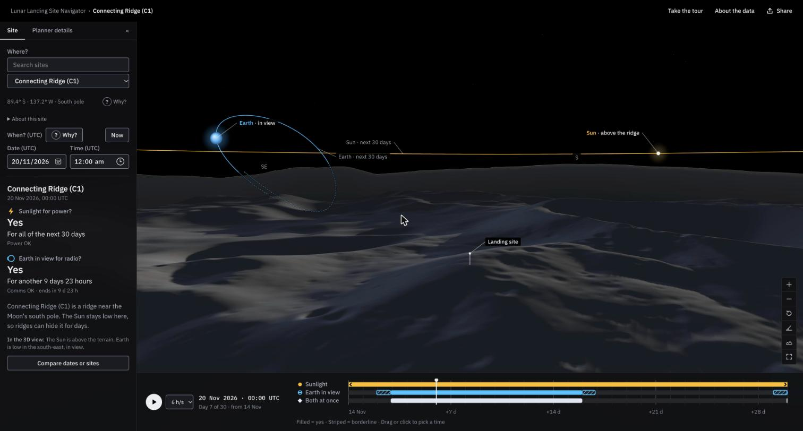

# Lunar Landing Site Navigator

Pick a lunar site and a date. See the real terrain around the site in 3D, with the Sun and Earth over its horizon, and get plain answers: is there sunlight, is Earth in view, and when does that change? A time dock shows the next 30 days. A compare drawer puts up to four site and date options side by side, for example "what if launch slips two weeks?".

**Live demo:** https://lunar-landing-site-navigator-alpha.vercel.app




Built for the NASA Space Apps Challenge 2026 (Lunar Landing Site Navigator challenge). Not affiliated with or endorsed by NASA.

## The problem

Near the Moon's south pole the Sun stays close to the horizon, so ridges and crater rims decide when a site has light. Earth also drifts in and out of view, which decides when a lander has a direct line to it. Existing tools are slow for asking "what happens at this site if the date moves?"

## What it does

**For a mission planner**
- **Two plain answers.** "Sunlight for power?" and "Earth in view for radio?" Each says Yes, Not yet or No, and how long until it changes. Power OK means at least half of the Sun's disk is above the horizon. Comms OK means the centre of Earth's disk is at least 0.5° above the horizon. These are geometry rules, not power or link budgets.
- **Time dock.** Three lanes cover the next 30 days: Sunlight, Earth in view and Both at once. Filled means yes. Striped means borderline. Drag or click to pick a time, or press Play to run the sky forward.
- **Planner details tab.** Elevation above terrain, visible disk, azimuth, time to the next change, and a short "How accurate is it?" note.
- **Compare drawer.** Up to four options, each with its own site, start date and delay (-60 to +60 days). It shows sunlight share, longest dark period and a one-line verdict.
- **Share link and CSV.** The URL stores the site, dates and options. A CSV export lists the windows.

**For an educator or student**
- **Full-screen 3D view.** Real LOLA terrain around the site, with a 120 km context tile (about 470 m cells) around the finer 20 km tile. Thin lines show the Sun and Earth paths.
- **Why? buttons and a guided tour** explain why the Sun stays low near the pole.
- **35 curated sites:** Apollo, Luna, Chang'e, Chandrayaan-3, SLIM, commercial landers, Artemis III candidate regions and south-pole reference points. You can also enter your own latitude and longitude.

**For the public**
- No login or install. Open the link and drag the time dock.

**How to use it:** pick a site and a UTC date, read the two answers, drag the time dock or press Play, open Compare to test a delay or another site, then Share.

For the 14 curated south-pole sites (at or south of 80°S) the horizon is real terrain. Every other site, custom coordinates included, uses a flat 0° horizon, and the app shows a "Smooth-Moon horizon, terrain not included" badge.

## How it works

1. **Positions.** The browser computes the Sun and Earth as seen from the site with [astronomy-engine](https://github.com/cosinekitty/astronomy). It uses the Moon's mean-Earth frame on a 1737.4 km sphere. No server is involved.
2. **Terrain horizon.** A build script (`scripts/horizon`, Python) takes elevation data and casts 720 rays (0.5° apart) out to 300 km from each site, with an observer 2 m above the ground. It stores the highest angle on each ray in `public/horizons/<site>.json`. The data are the 5 m PGDA site tiles near the site where one exists, then the 80 m and 240 m LOLA polar grids. Curvature is included. The method follows Mazarico et al. 2011 and Barker et al. 2021.
3. **Windows.** A 10-minute scan, refined to 1 minute, finds when each body crosses the horizon.
4. **3D tiles.** `scripts/horizon/terrain_tile.py` writes two 257 by 257 height grids per site for the 3D view: a 20 km near tile and, with `--wide`, a 120 km context tile. The wide tile smooths out features smaller than about 500 m. It is for context, not for measuring.

## Validation

The positions were compared with airless output from [JPL Horizons](https://ssd.jpl.nasa.gov/horizons/) at Apollo 11, Chandrayaan-3 and Connecting Ridge: 162 points in all (27 for each of the Sun and Earth at each site). The data were fetched on 14 Nov 2026.

| Measure | Result |
|---|---|
| Largest elevation difference | 0.0063° (0.38 arcminutes) |
| Largest azimuth difference times cos(elevation) | 0.0063° |
| Test tolerance | 0.05° |

Figures: `src/data/validation.json`. Tests: `src/astro/`. Only positions were compared with Horizons. Terrain horizons were checked against an independent re-run of the ray march.

## Accuracy and limits

- **Geometry indices only.** Power OK and Comms OK are visibility rules. They are not power or link budgets.
- **Terrain coverage.** Terrain exists only for the 14 curated sites at or south of 80°S. Elsewhere the horizon is a flat 0°.
- **Terrain resolution.** 5 m only within 5 km of a site where a tile exists, then 80 m and 240 m. 
- **Reach.** Rays stop at 300 km or at 75°S, where the elevation grids end.
- **Timing is sensitive near the poles.** A tiny angle error can move a rise or set time by an hour or more. There is no refraction correction, on purpose.
- **Artemis III coordinates** are reference points, not landing points.

## Run locally

Node.js is required.

```sh
npm ci
npm run dev       # local dev server
npm run check     # typecheck, tests and production build
```

To regenerate the horizon profiles and 3D tiles, see [`scripts/horizon/README.md`](scripts/horizon/README.md). It needs Python 3.12 or 3.13 and about 0.8 GB of source data, not stored in the repo.

## Data sources and credits

| Item | Link | Licence or terms |
|---|---|---|
| LOLA polar elevation grids (80 m, 240 m), NASA PDS Geosciences Node | https://pds-geosciences.wustl.edu/lro/lro-l-lola-3-rdr-v1/lrolol_1xxx/data/lola_gdr/polar/img/ | Public NASA data (terms not independently checked) |
| High-resolution LOLA topography for south pole sites, 5 m (PGDA product 78) | https://pgda.gsfc.nasa.gov/products/78 | Public NASA data (terms not independently checked) |
| JPL Horizons (validation only; the app does not call it) | https://ssd.jpl.nasa.gov/horizons/ | Public NASA/JPL service (terms not independently checked) |
| NSSDC lunar landing sites | https://nssdc.gsfc.nasa.gov/planetary/lunar/lunar_sites.html | NASA data (terms not independently checked) |
| USGS Gazetteer of Planetary Nomenclature | https://planetarynames.wr.usgs.gov | USGS data (terms not independently checked) |
| LROC positions | https://lroc.im-ldi.com | Credit: NASA/GSFC/Arizona State University |
| Wikipedia, list of artificial objects on the Moon (some site coordinates) | https://en.wikipedia.org/wiki/List_of_artificial_objects_on_the_Moon | CC BY-SA 4.0 |
| Gläser et al. 2018, illumination at the south pole | https://ntrs.nasa.gov/api/citations/20170007365/downloads/20170007365.pdf | Cited paper |
| Barker et al. 2021, Planetary and Space Science 203, 105119 | https://doi.org/10.1016/j.pss.2020.105119 | Cited paper |
| Mazarico et al. 2011, Icarus 211, 1066 | https://doi.org/10.1016/j.icarus.2010.10.030 | Cited paper |
| astronomy-engine (Don Cross) | https://github.com/cosinekitty/astronomy | MIT |
| React and React DOM | https://react.dev | MIT |
| three.js | https://threejs.org | MIT |
| IBM Plex Sans and IBM Plex Mono (self-hosted in `public/fonts/`) | https://github.com/IBM/plex | SIL Open Font License 1.1 (`public/fonts/OFL.txt`) |

Chandrayaan-3 (ISRO) and SLIM (JAXA) positions come from the USGS Gazetteer and public lists of artificial objects on the Moon. Build tools and Python packages are listed in `package.json` and `scripts/horizon/README.md`.

## Licence

MIT. See [LICENSE](LICENSE).
